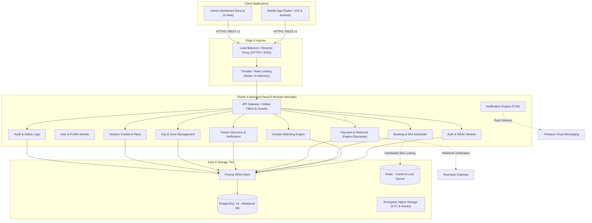

# TRAIN X — Product Architecture Specification

## 1. Executive Summary
**TRAIN X** is an on-demand, premium personal fitness trainer booking platform designed to connect verified, elite fitness trainers with clients. 
The initial market launch focuses on one configurable tier-1 metropolitan city in India (e.g., Mumbai or Bengaluru) with an architecture intentionally designed for rapid, zero-downtime expansion into multi-city, multi-zone operations.

---

## 2. Core Business Principles & Rules

### 2.1 Three Primary User Roles
1. **CLIENT**: End consumers who discover trainers, purchase credit packages, schedule sessions, and track their fitness journey.
2. **TRAINER**: Professional fitness instructors and coaches who manage their credentials, availability, scheduled sessions, client rosters, and earnings.
3. **ADMIN**: Platform operators with administrative access to approve trainers, review KYC documents, audit transactions, manage cities/zones, configure platform pricing, and handle disputes/safety reports. **Admin accounts are never publicly registrable.**

### 2.2 Mandatory Gender-Matching Safety Rule
- **Male Clients can ONLY discover, view, and book Male Trainers.**
- **Female Clients can ONLY discover, view, and book Female Trainers.**
- **Crucial Architectural Mandate**: This rule is strictly enforced at the **backend business logic and database query level**. The mobile and web frontends do not simply filter out trainers visually; the API rejects any search query, profile inspection, or booking transaction that attempts a cross-gender match, returning an explicit `403 Forbidden` domain error.

### 2.3 Trainer Verification Gate
- Only trainers who are:
  1. `isApproved == true` (verified by Admin after background and certification check)
  2. `isActive == true` (active subscription/profile)
  3. `isAvailable == true` (open session slots)
  are discoverable in search and bookable by clients.

---

## 3. High-Level System Architecture

---

## 4. Centrally Managed Platform Pricing & Session Credits

All trainers operate under unified, platform-wide standardized pricing tiers. Trainers do not set arbitrary individual rates during phase 1.

| Plan Code | Duration | Price (INR) | Included Sessions | Validity | Price / Session |
|---|---|---:|---:|---:|---:|
| `PLAN_1D` | 1 Day | ₹500 | 1 | 1 day | ₹500.00 |
| `PLAN_3D` | 3 Days | ₹1,399 | 3 | 3 days | ₹466.33 |
| `PLAN_1W` | 1 Week | ₹2,799 | 6 | 7 days | ₹466.50 |
| `PLAN_1M` | 1 Month | ₹10,799 | 26 | 30 days | ₹415.35 |
| `PLAN_3M` | 3 Months | ₹29,999 | 78 | 90 days | ₹384.60 |
| `PLAN_6M` | 6 Months (Transformation) | ₹52,999 | 150 | 180 days | ₹353.33 |

- **Session Duration**: Strictly 60 minutes per session.
- **Credit Lifecycle**:
  - Purchase of a plan issues `SessionCredits` tied to the client account.
  - Booking an appointment places a credit into an escrow hold (`RESERVED`).
  - Upon session completion (verified by OTP or QR code handshake), credit transitions to `CONSUMED`.
  - Cancellations adhering to the 4-hour cancellation policy return the credit to `ACTIVE`.

---

## 5. Planned 24 Functional Modules

1. **Authentication & Authorization**: JWT token pair, refresh rotation, password hashing (Argon2id/bcrypt), MFA for Admin.
2. **User Profiles**: Shared identity, email, verified mobile number, gender, avatar, status.
3. **Client Profiles**: Fitness goals, experience level, emergency contact, active credits, saved locations.
4. **Trainer Profiles**: Certifications, specialization tags, years of experience, rating, verification status, payout info.
5. **Gender-Based Trainer Matching**: Deterministic, query-level enforcement guaranteeing same-gender discovery.
6. **Trainer Onboarding & Verification**: Document uploads (Aadhaar, REPs/ACE/ACSM certificates), admin verification workflow.
7. **City & Service-Area Management**: Configurable cities (Mumbai, Bengaluru, Delhi NCR) with geo-fenced postal/pin zones.
8. **Trainer Discovery & Search**: Location-aware, specialty-filtered search returning only approved same-gender trainers.
9. **Subscription / Package Plans**: Centrally managed pricing catalog with active date boundaries and promo codes.
10. **Session Credits**: Ledger-backed credit tracking with expiration date tracking and FIFO deduction.
11. **Trainer Availability**: Recurring weekly schedules + explicit exception slots (60-minute blocks).
12. **Booking & Scheduling**: Atomic slot reservation preventing double-booking using transactional locks.
13. **Razorpay Payments**: Server-initiated order generation, currency enforcement (INR), tamper-proof signature check.
14. **Payment Verification & Webhooks**: Cryptographic HMAC-SHA256 signature verification and idempotent event ingestion.
15. **Refund Management**: Credit restoration rules, payment refund integration for administrative resolutions.
16. **Client Dashboard**: Next scheduled session, remaining credit balance, trainer card, session history.
17. **Trainer Dashboard**: Today's schedule, client attendance validation, accumulated earnings summary.
18. **In-App Messaging**: Safe communication channel for scheduled sessions without exposing private phone numbers.
19. **Push Notifications**: FCM push delivery for booking reminders, schedule changes, and approvals.
20. **Reviews & Ratings**: Verified-only reviews (client can only rate after a completed session).
21. **Reports & Safety**: Zero-tolerance incident reporting, instant emergency escalation, profile flagging.
22. **Admin Dashboard**: Web portal for verification queue, dispute resolution, analytics, and platform config.
23. **Audit Logs**: Immutable log of sensitive admin actions (approvals, manual adjustments, refund triggers).
24. **Platform Configuration**: Dynamic control over active cities, cancellation windows, and feature toggles.
