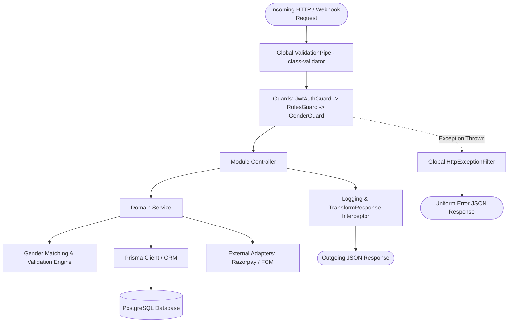

# TRAIN X — Backend Architecture Specification

## 1. Architectural Philosophy
The backend is the **sole source of truth** for all business rules, identity checks, permissions, financial values, and state transitions. 
No client application (mobile or web) is ever trusted with:
- Calculating prices or discount amounts
- Enforcing user roles or admin privileges
- Enforcing gender matching constraints
- Confirming payment success
- Determining trainer booking slot availability

---

## 2. NestJS Layered Architecture

---

## 3. Core Modules & Responsibilities

### 3.1 AuthModule
- Issues short-lived access JWTs (15 minutes) and cryptographically random, hashed refresh tokens (7 days).
- Implements refresh token rotation: each refresh token can be used once; detecting token re-use revokes all active sessions for that user.
- Admin login requires explicit `Role.ADMIN` and rejects normal credentials with generic authentication failure to prevent user enumeration.

### 3.2 MatchingModule (Gender Matching Engine)
- Serves as the security boundary for the platform's non-negotiable safety invariant:
  - When a Client performs a trainer discovery query, the client's verified gender is extracted directly from the verified JWT payload (`req.user.gender`).
  - The query is strictly appended with `WHERE trainer.gender = req.user.gender`.
  - When booking a slot (`POST /api/v1/bookings`), the backend executes a transactional read verifying:
    `client.gender === trainer.gender`. If mismatched, it immediately aborts with `403 Forbidden` (`GENDER_MISMATCH_DISALLOWED`).

### 3.3 PlansModule (Platform Pricing)
- Exposes readonly endpoints for clients and mobile apps: `GET /api/v1/plans`.
- Contains the immutable pricing table:
  - 1 Day: ₹500 (1 session, 1 day)
  - 3 Days: ₹1,399 (3 sessions, 3 days)
  - 1 Week: ₹2,799 (6 sessions, 7 days)
  - 1 Month: ₹10,799 (26 sessions, 30 days)
  - 3 Months: ₹29,999 (78 sessions, 90 days)
  - 6 Months: ₹52,999 (150 sessions, 180 days)
- Clients can only supply a `planId`. The backend looks up the exact price and session count in the database before generating a Razorpay order.

### 3.4 PaymentsModule & Webhooks
- **Order Generation**: `POST /api/v1/payments/create-order` creates a Razorpay Order in paise (INR).
- **Client Verification**: `POST /api/v1/payments/verify` takes `razorpay_order_id`, `razorpay_payment_id`, and `razorpay_signature`. The backend re-computes `crypto.createHmac('sha256', secret)` and compares using constant-time buffer equality (`crypto.timingSafeEqual`).
- **Webhook Processing**: `POST /api/v1/payments/webhook` listens for asynchronous Razorpay events (e.g., `payment.captured`, `refund.processed`) to guarantee credit delivery even if the client disconnects immediately after payment.

### 3.5 BookingsModule
- Enforces the 60-minute session block.
- Manages states:
  `REQUESTED` → `CONFIRMED` → `IN_PROGRESS` → `COMPLETED` | `CANCELLED` | `NO_SHOW`
- Enforces cancellation policies:
  - > 4 hours before slot: Full credit refund to client.
  - < 4 hours before slot: Credit consumed, non-refundable (protects trainer schedule).
