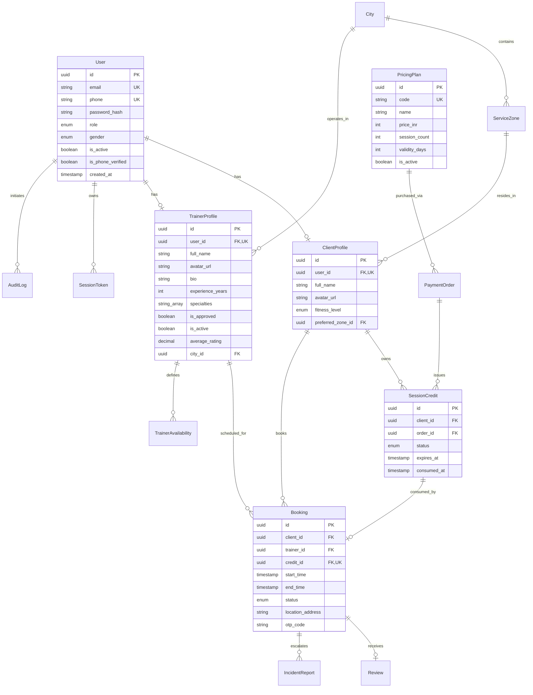

# TRAIN X — Database Architecture & Schema Plan

## 1. Overview & Technology
- **Database Engine**: PostgreSQL 16 (ACID-compliant relational engine)
- **Object-Relational Mapping**: Prisma ORM 5+
- **Naming Conventions**: `snake_case` for database column names; `camelCase` for TypeScript/Prisma entity fields.
- **Auditing**: All operational tables contain `created_at` and `updated_at` timestamps.

---

## 2. Entity-Relationship Diagram



---

## 3. Comprehensive Prisma Schema Definition

```prisma
datasource db {
  provider = "postgresql"
  url      = env("DATABASE_URL")
}

generator client {
  provider = "prisma-client-js"
}

// ─── Enums ────────────────────────────────────────────────────────────────────

enum Role {
  CLIENT
  TRAINER
  ADMIN
}

enum Gender {
  MALE
  FEMALE
}

enum FitnessLevel {
  BEGINNER
  INTERMEDIATE
  ADVANCED
}

enum CreditStatus {
  ACTIVE
  RESERVED
  CONSUMED
  EXPIRED
  REFUNDED
}

enum BookingStatus {
  REQUESTED
  CONFIRMED
  IN_PROGRESS
  COMPLETED
  CANCELLED_BY_CLIENT
  CANCELLED_BY_TRAINER
  NO_SHOW
}

enum PaymentStatus {
  PENDING
  SUCCESS
  FAILED
  REFUNDED
}

// ─── Models ───────────────────────────────────────────────────────────────────

model User {
  id                String          @id @default(uuid()) @db.Uuid
  email             String          @unique @db.VarChar(255)
  phone             String          @unique @db.VarChar(20)
  passwordHash      String          @map("password_hash") @db.VarChar(255)
  role              Role
  gender            Gender
  isActive          Boolean         @default(true) @map("is_active")
  isPhoneVerified   Boolean         @default(false) @map("is_phone_verified")
  createdAt         DateTime        @default(now()) @map("created_at")
  updatedAt         DateTime        @updatedAt @map("updated_at")

  clientProfile     ClientProfile?
  trainerProfile    TrainerProfile?
  sessionTokens     SessionToken[]
  auditLogs         AuditLog[]

  @@index([role, gender, isActive])
  @@map("users")
}

model SessionToken {
  id           String    @id @default(uuid()) @db.Uuid
  userId       String    @map("user_id") @db.Uuid
  tokenHash    String    @unique @map("token_hash") @db.VarChar(255)
  isRevoked    Boolean   @default(false) @map("is_revoked")
  expiresAt    DateTime  @map("expires_at")
  createdAt    DateTime  @default(now()) @map("created_at")

  user         User      @relation(fields: [userId], references: [id], onDelete: Cascade)

  @@index([userId, isRevoked])
  @@map("session_tokens")
}

model City {
  id           String        @id @default(uuid()) @db.Uuid
  name         String        @unique @db.VarChar(100)
  state        String        @db.VarChar(100)
  isActive     Boolean       @default(true) @map("is_active")
  createdAt    DateTime      @default(now()) @map("created_at")
  updatedAt    DateTime      @updatedAt @map("updated_at")

  zones        ServiceZone[]
  trainers     TrainerProfile[]

  @@map("cities")
}

model ServiceZone {
  id           String         @id @default(uuid()) @db.Uuid
  cityId       String         @map("city_id") @db.Uuid
  name         String         @db.VarChar(100)
  pincode      String         @db.VarChar(10)
  isActive     Boolean        @default(true) @map("is_active")

  city         City           @relation(fields: [cityId], references: [id], onDelete: Cascade)
  clients      ClientProfile[]

  @@unique([cityId, pincode])
  @@map("service_zones")
}

model ClientProfile {
  id               String          @id @default(uuid()) @db.Uuid
  userId           String          @unique @map("user_id") @db.Uuid
  fullName         String          @map("full_name") @db.VarChar(150)
  avatarUrl        String?         @map("avatar_url") @db.Text
  fitnessLevel     FitnessLevel    @default(BEGINNER) @map("fitness_level")
  primaryGoal      String?         @map("primary_goal") @db.VarChar(255)
  preferredZoneId  String?         @map("preferred_zone_id") @db.Uuid
  createdAt        DateTime        @default(now()) @map("created_at")
  updatedAt        DateTime        @updatedAt @map("updated_at")

  user             User            @relation(fields: [userId], references: [id], onDelete: Cascade)
  preferredZone    ServiceZone?    @relation(fields: [preferredZoneId], references: [id])
  credits          SessionCredit[]
  bookings         Booking[]
  payments         PaymentOrder[]
  reviewsWritten   Review[]

  @@map("client_profiles")
}

model TrainerProfile {
  id               String                @id @default(uuid()) @db.Uuid
  userId           String                @unique @map("user_id") @db.Uuid
  fullName         String                @map("full_name") @db.VarChar(150)
  avatarUrl        String?               @map("avatar_url") @db.Text
  bio              String?               @db.Text
  experienceYears  Int                   @default(0) @map("experience_years")
  specialties      String[]              @default([])
  cityId           String                @map("city_id") @db.Uuid
  isApproved       Boolean               @default(false) @map("is_approved")
  isActive         Boolean               @default(true) @map("is_active")
  averageRating    Decimal               @default(5.00) @map("average_rating") @db.Decimal(3, 2)
  reviewCount      Int                   @default(0) @map("review_count")
  createdAt        DateTime              @default(now()) @map("created_at")
  updatedAt        DateTime              @updatedAt @map("updated_at")

  user             User                  @relation(fields: [userId], references: [id], onDelete: Cascade)
  city             City                  @relation(fields: [cityId], references: [id])
  availabilities   TrainerAvailability[]
  bookings         Booking[]
  reviewsReceived  Review[]

  @@index([cityId, isApproved, isActive])
  @@map("trainer_profiles")
}

model PricingPlan {
  id             String          @id @default(uuid()) @db.Uuid
  code           String          @unique @db.VarChar(50) // e.g. PLAN_1M
  name           String          @db.VarChar(100)        // e.g. "1 Month"
  priceInr       Int             @map("price_inr")       // e.g. 10799
  sessionCount   Int             @map("session_count")   // e.g. 26
  validityDays   Int             @map("validity_days")   // e.g. 30
  isActive       Boolean         @default(true) @map("is_active")
  createdAt      DateTime        @default(now()) @map("created_at")
  updatedAt      DateTime        @updatedAt @map("updated_at")

  orders         PaymentOrder[]

  @@map("pricing_plans")
}

model PaymentOrder {
  id                 String          @id @default(uuid()) @db.Uuid
  clientId           String          @map("client_id") @db.Uuid
  planId             String          @map("plan_id") @db.Uuid
  amountInr          Int             @map("amount_inr")
  currency           String          @default("INR") @db.VarChar(5)
  razorpayOrderId    String          @unique @map("razorpay_order_id") @db.VarChar(100)
  razorpayPaymentId  String?         @map("razorpay_payment_id") @db.VarChar(100)
  status             PaymentStatus   @default(PENDING)
  createdAt          DateTime        @default(now()) @map("created_at")
  updatedAt          DateTime        @updatedAt @map("updated_at")

  client             ClientProfile   @relation(fields: [clientId], references: [id])
  plan               PricingPlan     @relation(fields: [planId], references: [id])
  creditsIssued      SessionCredit[]

  @@map("payment_orders")
}

model SessionCredit {
  id             String        @id @default(uuid()) @db.Uuid
  clientId       String        @map("client_id") @db.Uuid
  orderId        String        @map("order_id") @db.Uuid
  status         CreditStatus  @default(ACTIVE)
  expiresAt      DateTime      @map("expires_at")
  consumedAt     DateTime?     @map("consumed_at")
  createdAt      DateTime      @default(now()) @map("created_at")

  client         ClientProfile @relation(fields: [clientId], references: [id])
  order          PaymentOrder  @relation(fields: [orderId], references: [id])
  booking        Booking?

  @@index([clientId, status, expiresAt])
  @@map("session_credits")
}

model TrainerAvailability {
  id           String        @id @default(uuid()) @db.Uuid
  trainerId    String        @map("trainer_id") @db.Uuid
  dayOfWeek    Int           @map("day_of_week") // 0 = Sunday, 1 = Monday...
  startHour    Int           @map("start_hour")  // 6 = 06:00
  endHour      Int           @map("end_hour")    // 22 = 22:00
  isAvailable  Boolean       @default(true) @map("is_available")

  trainer      TrainerProfile @relation(fields: [trainerId], references: [id], onDelete: Cascade)

  @@unique([trainerId, dayOfWeek, startHour])
  @@map("trainer_availabilities")
}

model Booking {
  id               String          @id @default(uuid()) @db.Uuid
  clientId         String          @map("client_id") @db.Uuid
  trainerId        String          @map("trainer_id") @db.Uuid
  creditId         String          @unique @map("credit_id") @db.Uuid
  startTime        DateTime        @map("start_time")
  endTime          DateTime        @map("end_time")
  status           BookingStatus   @default(REQUESTED)
  locationAddress  String          @map("location_address") @db.Text
  otpCode          String          @map("otp_code") @db.VarChar(6)
  cancelledReason  String?         @map("cancelled_reason") @db.Text
  createdAt        DateTime        @default(now()) @map("created_at")
  updatedAt        DateTime        @updatedAt @map("updated_at")

  client           ClientProfile   @relation(fields: [clientId], references: [id])
  trainer          TrainerProfile  @relation(fields: [trainerId], references: [id])
  credit           SessionCredit   @relation(fields: [creditId], references: [id])
  review           Review?
  incidents        IncidentReport[]

  @@unique([trainerId, startTime])
  @@index([clientId, status])
  @@index([trainerId, status])
  @@map("bookings")
}

model Review {
  id           String         @id @default(uuid()) @db.Uuid
  bookingId    String         @unique @map("booking_id") @db.Uuid
  clientId     String         @map("client_id") @db.Uuid
  trainerId    String         @map("trainer_id") @db.Uuid
  rating       Int            @db.SmallInt // 1 to 5
  comment      String?        @db.Text
  createdAt    DateTime       @default(now()) @map("created_at")

  booking      Booking        @relation(fields: [bookingId], references: [id])
  client       ClientProfile  @relation(fields: [clientId], references: [id])
  trainer      TrainerProfile @relation(fields: [trainerId], references: [id])

  @@map("reviews")
}

model IncidentReport {
  id           String        @id @default(uuid()) @db.Uuid
  bookingId    String?       @map("booking_id") @db.Uuid
  reporterId   String        @map("reporter_id") @db.Uuid
  reason       String        @db.VarChar(255)
  description  String        @db.Text
  isResolved   Boolean       @default(false) @map("is_resolved")
  createdAt    DateTime      @default(now()) @map("created_at")

  booking      Booking?      @relation(fields: [bookingId], references: [id])

  @@map("incident_reports")
}

model AuditLog {
  id           String        @id @default(uuid()) @db.Uuid
  userId       String?       @map("user_id") @db.Uuid
  action       String        @db.VarChar(100)
  resource     String        @db.VarChar(100)
  resourceId   String?       @map("resource_id") @db.VarChar(100)
  payloadJson  Json?         @map("payload_json")
  ipAddress    String?       @map("ip_address") @db.VarChar(50)
  createdAt    DateTime      @default(now()) @map("created_at")

  user         User?         @relation(fields: [userId], references: [id])

  @@index([userId, action])
  @@map("audit_logs")
}
```
