# TRAIN X — Master Development Roadmap

```mermaid
flowchart LR
    P0["Prompt 0: Foundation & Arch (CURRENT)"] --> P1["Prompt 1: Backend Setup & DB Schema"]
    P1 --> P2["Prompt 2: Auth, Roles & Gender Engine"]
    P2 --> P3["Prompt 3: Plans, Credits & Razorpay"]
    P3 --> P4["Prompt 4: Trainer Discovery & Booking"]
    P4 --> P5["Prompt 5: Flutter App Restructure & State"]
    P5 --> P6["Prompt 6: Admin Dashboard Next.js"]
    P6 --> P7["Prompt 7: Realtime, FCM & Polishing"]
```

---

## Phase Breakdown

### Phase 0: Project Foundation & Architecture (Current Milestone)
- ✅ Inspect system tools (Node 24, Flutter 3.47, Dart 3.13, PostgreSQL 16).
- ✅ Establish monorepo structure: `mobile/`, `backend/`, `admin/`, `documentation/`.
- ✅ Complete foundational documentation & database schema specification.
- ✅ Establish development roadmap.

### Phase 1: Backend Initialization, Prisma ORM & Database Schema
- Initialize NestJS project in `backend/` with TypeScript, ESLint, Prettier, and Swagger.
- Configure Prisma with PostgreSQL connection (`trainx_dev`).
- Execute initial migration and database seed script (cities: Mumbai/Bengaluru; pricing plans: 1D, 3D, 1W, 1M, 3M, 6M; seed admin user).
- Implement global filters, logging interceptors, and response transformer pipes.

### Phase 2: Authentication, Authorization & Gender Matching Engine
- Implement user registration (Client & Trainer) and JWT authentication with refresh token rotation.
- Create `RolesGuard` and strict `GenderMatchingGuard`.
- Build Client and Trainer onboarding profile endpoints.
- Write automated unit and integration tests verifying that cross-gender queries fail with 403.

### Phase 3: Plans Catalog, Session Credits & Razorpay Payments
- Build standardized pricing catalog endpoints (`GET /api/v1/plans`).
- Implement Razorpay server-side order generation and signature verification.
- Implement webhook receiver with HMAC-SHA256 signature validation.
- Implement FIFO session credit ledger and expiration logic.

### Phase 4: Trainer Availability, Discovery & Slot Booking
- Implement Trainer recurring availability and schedule exception management.
- Implement location-based, gender-matched trainer discovery search.
- Implement atomic 60-minute slot booking with transactional lock and credit deduction.
- Implement OTP handshake verification for session start/completion.

### Phase 5: Mobile Application Modernization (Flutter + Riverpod)
- Integrate `flutter_riverpod`, `go_router`, and `dio` into `mobile/`.
- Implement clean feature-first architecture (`core/` + `features/`).
- Build API interceptors with automatic token refresh rotation.
- Connect Splash, Login, Signup, Client Dashboard, and Trainer Dashboard to live backend APIs.
- Build Trainer Discovery, Slot Picker, and Checkout screens.

### Phase 6: Admin Dashboard (Next.js 14 Web)
- Set up Next.js 14 App Router project in `admin/` with Tailwind CSS.
- Build Admin authentication and route protection.
- Implement Trainer Verification queue with document review and approval actions.
- Build Platform Analytics, Audit Logs viewer, and Pricing/City toggle management.

### Phase 7: Push Notifications, Reviews, Safety & Hardening
- Implement Firebase Cloud Messaging (FCM) push notifications for booking alerts.
- Build verified review and rating module.
- Build SOS emergency and safety reporting workflow.
- Complete end-to-end integration and smoke testing.
